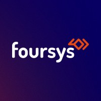

### Hello Network 👋


<p align="left"> 
  My name is <strong>Renato Rocha</strong> – Web Developer with a strong interest in Data Science, Machine Learning, and Artificial Intelligence.
  <br>
  
  I am currently pursuing a <strong>Postgraduate Degree in Full-Stack Development with a focus on Artificial Intelligence</strong> and continuously expanding my knowledge in data-driven technologies.
</p>

---

### 🔗 Links

<p align="left">
<a href="https://github.com/renatorrocha" target="blank"></a>
<a href="https://linkedin.com/in/renato-rrodrigues" target="blank"></a>
</p>

---

```ts
import Developer from '@renatorrocha';

class About extends Developer {
  constructor() {
    super({
      name: 'Renato Rocha Rodrigues',
      area: 'Fullstack and AI enthusiast',
      work: 'ISH/Vision Cybersecurity',
      state: 'Espírito Santo, ES'
    });
  }
}
```

<h4>Languages</h4>


<h4>Frameworks & Libraries</h4>


<h4>Databases & Messaging</h4>


<h4>Cloud & DevOps</h4>


<h4>Mobile</h4>


<h4>AI & Tools</h4>


---

## 💼 Work Experience

<br/>

[](https://visioncybersecurity.com/)
**Fullstack Developer IV** \
[ISH/Vision Cybersecurity](https://visioncybersecurity.com/) • Jan 2026 - Present • Hybrid \
I mainly work on the internal portal, while also maintaining and evolving other company systems: features from planning to staging, legacy maintenance and migration, ticket support, and AI prototypes applied to the products. \
Languages & Technologies: `Next.js`, `Nest.js`, `PostgreSQL`, `Docker`
<br/>

<br/>

[](https://www.findes.com.br/)
**Fullstack Web Development** \
[Findes](https://www.findes.com.br/) • Aug 2023 - Jan 2026 • Contract \
Started as an **Intern**, then transitioned to a **Research Scholarship position**, and later worked as a **Junior Developer**. \
Languages & Technologies: `TypeScript`, `React - Vite`, `Figma`, `GitHub`, `Azure`, `Python`, `Node` 

<br/>

[](https://www.foursys.com.br/)
**Mobile Developer | Android Development Intern** \
[Foursys](https://www.foursys.com.br/) • Apr 2022 - Feb 2023 • 11 months • Contract \
Languages & Technologies: `Java`, `Kotlin`, `Figma`, `GitLab`, `Miro` \
Highlighted Projects: [4Pay](https://github.com/renatorrocha/4Pay), `BRAVVE`
